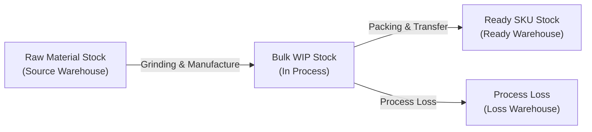
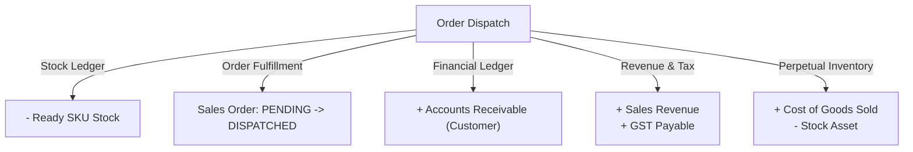
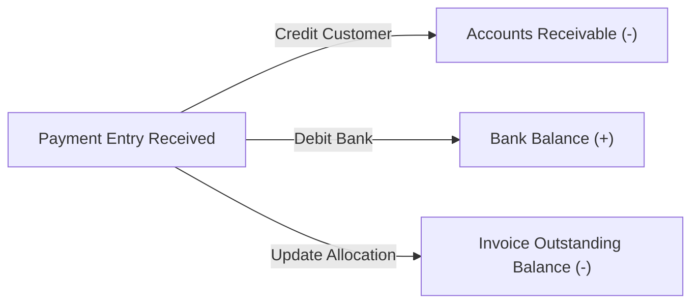

# Systems Thinking & Multi-Table Workflow Architecture

This document specifies the end-to-end operational and financial workflows of the ERP from a **Systems Thinking** perspective. It details the interplay of **stocks**, **flows**, **conservation laws**, **foreign key invariants**, **multi-table atomic mutations**, and **compensating rollbacks**.

---

## 1. Systems Thinking Framework in ERP

In systems dynamics, an enterprise consists of:
1. **Stocks (State / Accumulation)**: Quantities that accumulate over time.
   * *Physical Stocks*: Raw Materials, Work-in-Progress (WIP), Finished Goods SKUs, Process Loss/Scrap.
   * *Operational Demand Stocks*: Reserved Qty (Committed Demand), Ordered Qty (Pipeline Supply).
   * *Financial Ledger Stocks*: Accounts Receivable (Debtors), Accounts Payable (Creditors), Bank/Cash balances, Inventory Assets, Retained Earnings.
2. **Flows (Transactions / Rates of Change)**: Actions that alter stocks.
   * Material Consumption, Production, Order Placement, Shipment/Fulfillment, Billing, Payment Receipt, Bank Reconciliation.
3. **Conservation Invariants**:
   * *Conservation of Mass*: $\sum \text{Raw Materials Input} = \sum \text{Good Output (SKUs)} + \sum \text{By-products} + \sum \text{Process Loss}$.
   * *Conservation of Financial Value (Double Entry)*: $\sum \text{Debits} = \sum \text{Credits}$ at all times.
   * *Non-Negativity Constraint*: Physical stock ($\text{actual\_qty}$) must never drop below zero ($\text{actual\_qty} \ge 0$).

---

## 2. Core Workflows & Atomic Transaction Boundaries

### Workflow 1: Production Batch (Raw Materials $\rightarrow$ Bulk $\rightarrow$ Ready SKUs)

* **Systemic Nature**: Mass-conserving transformation.
* **Stocks Affected**:
  * Raw Materials Warehouse: Decreases ($-$)
  * Bulk In-Process (WIP) Warehouse: Intermediate $(+)$ then $(-)$
  * Process Loss / Scrap Warehouse: Increases $(+)$
  * Finished Goods / Ready Warehouse: Increases $(+)$
  * General Ledger: Credit Raw Material Asset, Debit Finished Goods Asset.



#### Multi-Table Atomic Boundary
All steps are executed inside `django.db.transaction.atomic()`:
1. `manufacturing.Batch` & `manufacturing.WorkOrder`: Progress updated (`produced_qty`, `status`).
2. `stock.StockEntry` & `stock.StockEntryItem`: Document header and line items generated.
3. `stock.StockLedgerEntry` (SLE): Immutable ledger postings written for each component consumed and output item produced.
4. `stock.Bin`: Cached balances (`actual_qty`, `stock_value`, `valuation_rate`) locked and recomputed for all affected item-warehouse pairs.
5. `accounts.GLEntry`: Dual-leg accounting entries posted:
   * `Credit`: Raw Material Inventory Account
   * `Debit`: Finished Goods Inventory Account

#### Rollback / Cancellation (`cancel_batch`)
* **Guard**: If any finished SKU from the batch has already been dispatched/sold, cancellation is blocked.
* **Compensating Action**:
  * Reverses all `StockEntry` records newest first.
  * Writes exact inverse `StockLedgerEntry` rows.
  * Restores `stock.Bin` actual quantities to their exact pre-batch levels.
  * Posts reversing `GLEntry` records.
  * Marks `WorkOrder` and `Batch` as `CANCELLED`.

---

### Workflow 2: Sales Order (Demand Commitment)

* **Systemic Nature**: Virtual commitment without physical stock movement.
* **Stocks Affected**:
  * Physical Stock (`actual_qty`): **0** (Unchanged)
  * Net Demand / Allocated Stock (`reserved_qty`): **Increases** $(+)$
  * Net Available for Sale (`projected_qty = actual_qty - reserved_qty`): **Decreases** $(-)$


#### Multi-Table Atomic Boundary
1. `selling.SalesOrder`: `docstatus` moves from `Draft (0)` to `Submitted (1)`.
2. `selling.SalesOrderItem`: Line item quantities, tax allocations, and selling rates frozen.
3. `selling.SalesOrder.dispatch_status`: Initialized to `PENDING`.
4. `core.AuditLog`: Audit trace recorded.

#### Rollback / Cancellation
* **Guard**: Refused if linked submitted `SalesInvoice` records exist.
* **Compensating Action**:
  * Atomically clears order commitment (`dispatch_status = CANCELLED`).
  * Re-evaluates demand projections, releasing inventory for other orders.

---

### Workflow 3: Fulfillment & Dispatch (Order Shipped & Invoiced)

* **Systemic Nature**: Physical asset hand-off in exchange for legal debt claim (Receivable).
* **Stocks Affected**:
  * Finished Goods SKU (`actual_qty`): **Decreases** $(-)$
  * Net Demand (`reserved_qty`): **Decreases** $(-)$
  * Customer Accounts Receivable: **Increases** $(+)$
  * Cost of Goods Sold (COGS Expense): **Increases** $(+)$
  * Inventory Stock Asset: **Decreases** $(-)$
  * Sales Revenue (Income): **Increases** $(+)$
  * GST Liability: **Increases** $(+)$



#### Multi-Table Atomic Boundary
Executed inside `dispatch_service.dispatch_order()`:
1. `selling.SalesOrder`: Row-locked (`select_for_update()`), checks remaining unfulfilled quantities.
2. `stock.Bin`: Verifies stock availability (`actual_qty >= dispatch_qty`). Refuses if insufficient.
3. `selling.SalesInvoice` & `selling.SalesInvoiceItem`: Created and submitted (`update_stock=True`).
4. `stock.StockLedgerEntry`: Outward stock ledger entries posted.
5. `stock.Bin`: `actual_qty` decremented.
6. `accounts.GLEntry`:
   * `Debit` Customer Receivable (`rounded_total`)
   * `Credit` Sales Income (`net_total`)
   * `Credit` Output CGST / SGST / IGST accounts
   * `Debit` Cost of Goods Sold (`outgoing_value`)
   * `Credit` Stock In Hand / Finished Goods asset (`outgoing_value`)
7. `selling.SalesInvoice.outstanding_amount`: Initialized to `rounded_total`.
8. `selling.SalesOrder.dispatch_status`: Recomputed and updated (`PART_DISPATCHED` or `DISPATCHED`).

#### Rollback / Cancellation
* **Guard**: Blocked if customer payments are allocated to this invoice or linked returns exist (`ensure_no_linked_payments()`).
* **Compensating Action**:
  * `gl_service.reverse(invoice)`: Reverses all accounting legs.
  * `stock_service.reverse(invoice)`: Restores physical inventory to `ready_warehouse`.
  * `dispatch_service.refresh_status(order)`: Reverts Sales Order dispatch status to `PART_DISPATCHED` or `PENDING`.
  * `outstanding_service.refresh(invoice)`: Clears outstanding balance to $0$.

---

### Workflow 4: Customer Payment & Settlement

* **Systemic Nature**: Asset transformation (Accounts Receivable $\rightarrow$ Liquid Bank Balance).
* **Stocks Affected**:
  * Customer Accounts Receivable: **Decreases** $(-)$
  * Bank Account Balance: **Increases** $(+)$
  * Invoice Outstanding Debt: **Decreases** $(-)$



#### Multi-Table Atomic Boundary
1. `accounts.PaymentEntry`: Submits payment header.
2. `accounts.PaymentEntryReference`: Locks referenced invoices and validates open amounts.
3. `selling.SalesInvoice.outstanding_amount`: Decremented by allocated amounts.
4. `accounts.GLEntry`:
   * `Debit` Bank / Cash Account
   * `Credit` Customer Party Account (tagged `against_voucher_no=invoice.name`)
5. `payment_reconciliation`: Statement line mapped to payment voucher.

#### Rollback / Cancellation
* **Compensating Action**:
  * `gl_service.reverse(payment)`: Reverses bank debit and debtor credit.
  * `_refresh_reference(invoice)`: Recomputes and restores `outstanding_amount` on each linked `SalesInvoice`.
  * Frees the bank statement line for re-matching.

---

## 3. Foreign Key Constraints as Conservation Protectors

Foreign keys enforce the hierarchy of causality:

| Foreign Key Pair | Constraint Type | Systemic Purpose |
| :--- | :--- | :--- |
| `SalesOrderItem.sales_order` $\rightarrow$ `SalesOrder` | `CASCADE` | Child rows live and die with the draft header document. |
| `SalesInvoice.sales_order` $\rightarrow$ `SalesOrder` | `PROTECT` | Prevents an order from being deleted while an invoice references it. |
| `SalesInvoice.customer` $\rightarrow$ `Customer` | `PROTECT` | Prevents deleting customer master data when debts/ledgers exist. |
| `PaymentEntryReference.reference_name` $\rightarrow$ `SalesInvoice` | `PROTECT` | Enforces reverse-chronological reversal: payment must be cancelled before invoice can be cancelled. |
| `StockLedgerEntry.item` $\rightarrow$ `Item` | `PROTECT` | An item with historical stock movements can never be deleted from the system. |
| `StockLedgerEntry.warehouse` $\rightarrow$ `Warehouse` | `PROTECT` | Prevents warehouse deletion if historical stock passes through it. |
| `WorkOrder.bom` $\rightarrow$ `BOM` | `PROTECT` | Prevents modifying or deleting a recipe while active production orders use it. |

---

## 4. Deletion Policy & Foreign Key Protection (No 500 Errors)

### Dual-Tier Deletion Architecture (Soft vs. Hard)

```
DELETE /api/<resource>/<id>/
           │
           ├──► User is Non-Admin (Standard User)
           │         │
           │         ├──► Master Model (has is_active):
           │         │      • Soft-deletes: sets is_active = False
           │         │      • Returns HTTP 200 OK + AuditLog("soft_delete")
           │         │
           │         ├──► Submittable Document (has docstatus):
           │         │      • If Draft (0): Soft-deletes by setting docstatus = CANCELLED (2)
           │         │      • If Submitted (1): Refused with HTTP 409 Conflict (Must Cancel & Amend)
           │         │
           │         └──► Other Models:
           │                • HTTP 403 Forbidden ("Hard delete restricted to administrators")
           │
           └──► User is Admin (is_superuser or System Manager)
                     │
                     └──► Hard Delete Attempt (instance.delete())
                               │
                               ├──► No Dependent References:
                               │      • Row physically removed from table
                               │      • Returns HTTP 204 No Content + AuditLog("delete")
                               │
                               └──► Protected by Foreign Key (models.PROTECT / RESTRICT):
                                      • Handled by core.exceptions.custom_exception_handler
                                      • NEVER throws HTTP 500 Internal Server Error!
                                      • Returns HTTP 409 Conflict with descriptive payload:
                                        "Cannot delete Customer 'Acme' because it is referenced by
                                         3 Sales Invoices (e.g. SINV-001). Please delete or reassign
                                         linked records first, or deactivate it instead."
```

### Global Foreign Key Exception Interceptor (`core.exceptions`)
To guarantee high availability and server stability, `core.exceptions.custom_exception_handler` intercepts all database constraint exceptions:
1. `ProtectedError`: Inspects `exc.protected_objects`, aggregates referenced models and samples, and returns clean `HTTP 409 Conflict`.
2. `RestrictedError`: Inspects `exc.restricted_objects` and returns clean `HTTP 409 Conflict`.
3. `IntegrityError`: Translates foreign key, unique, and check constraint failures into readable errors instead of an uncaught 500 crash.
4. `DjangoValidationError`: Converts model validation exceptions into `HTTP 400 Bad Request`.

